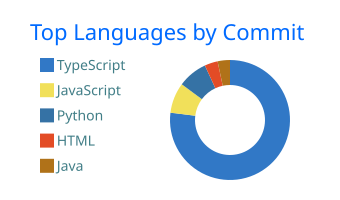
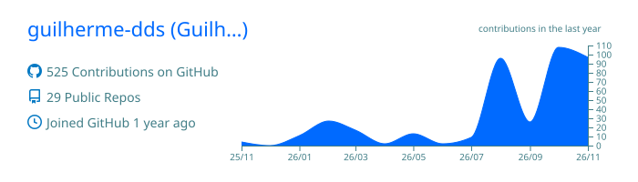

  

 

 

<table>
<tr>
<td width="58%" valign="top">

### Sobre

Me chamo **Guilherme Dias**, tenho 19 anos e sou natural do estado de São Paulo. Curso **Tecnologia em Sistemas Inteligentes** na **FATEC Pompéia Shunji Nishimura**.

Sou apaixonado por tecnologia desde muito jovem e estou em constante busca de aprendizado e crescimento profissional, sempre motivado a transformar curiosidade em soluções práticas.

 

**Idiomas**
 
Português (nativo) · Inglês (intermediário)

</td>
<td width="42%" valign="top" align="center">

 

</td>
</tr>
</table>

 

<b>FRONT-END</b>
  

  

<b>BACK-END · DADOS · FERRAMENTAS</b>
  

  

<b>AUTOMAÇÃO</b>
  

 

 

<!-- Descomente e substitua pelos seus dados:

-->

